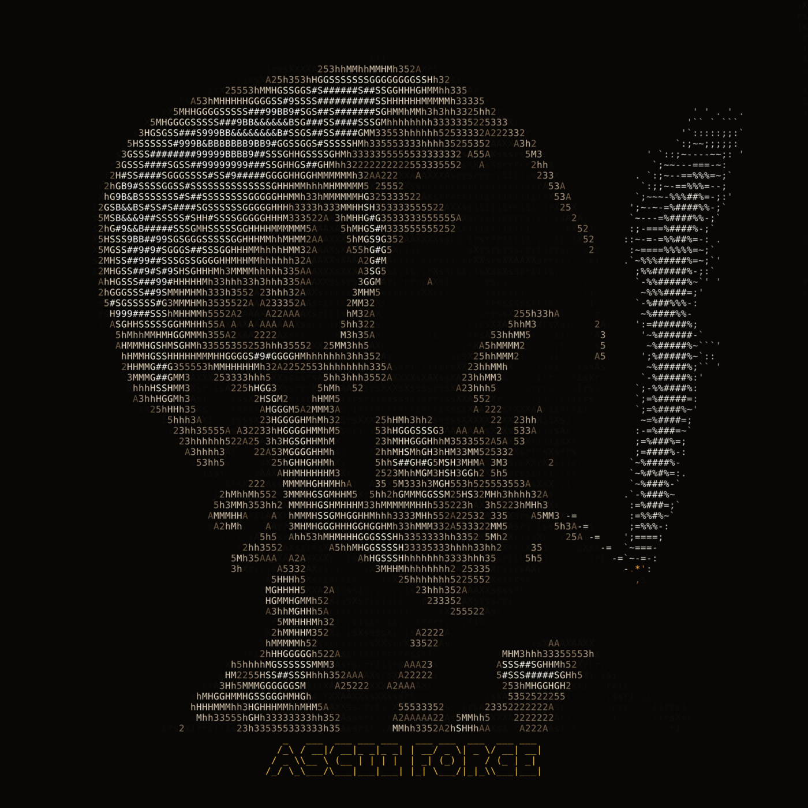
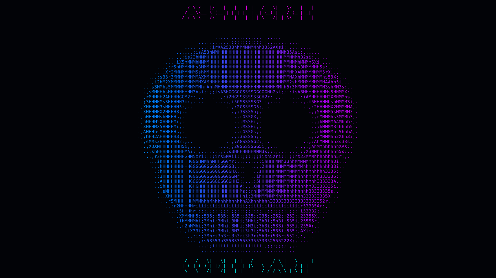
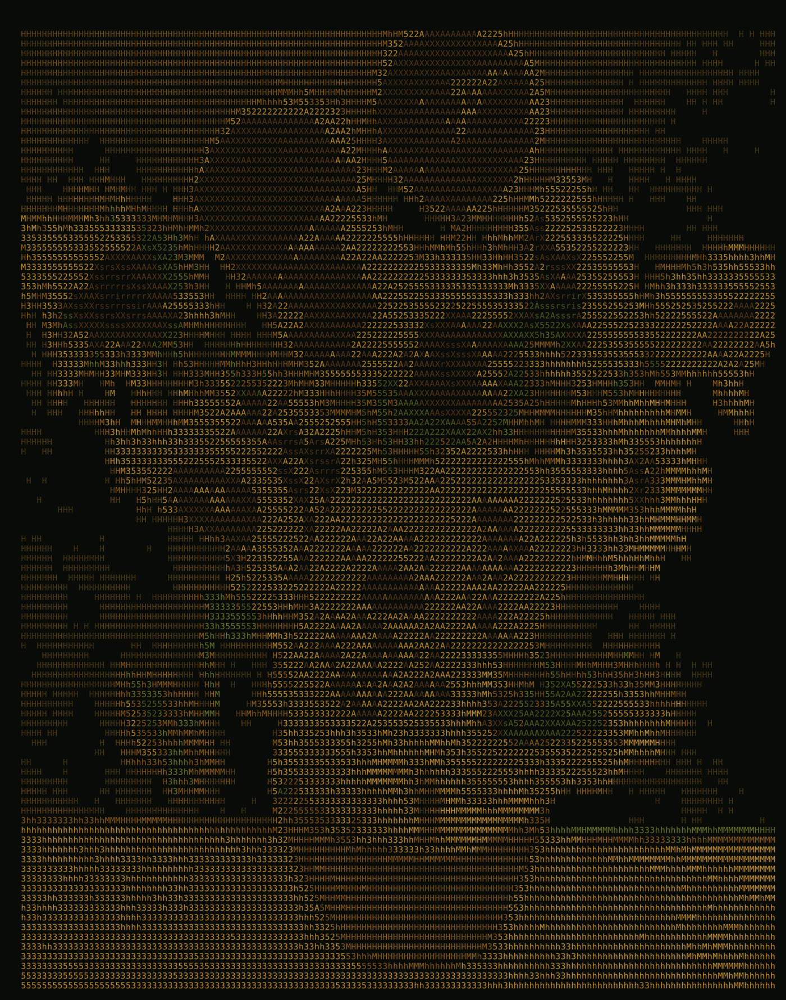
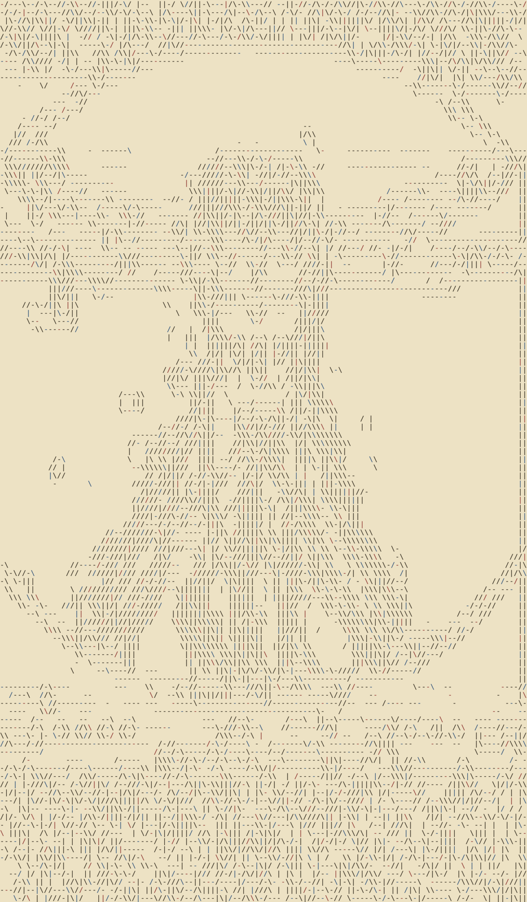

# Gallery

Visual examples generated with ASCII Forge. Each entry includes a still, an
animated GIF and an MP4. The source artworks are public domain; the ASCII,
palettes, effects and animation are original.

## ASCII Forge logo

[](../assets/logo/ascii-forge-logo.gif)

[PNG](../assets/logo/ascii-forge-logo.png) · [GIF](../assets/logo/ascii-forge-logo.gif) · [MP4](../assets/logo/ascii-forge-logo.mp4)

Van Gogh's skeleton, converted to ASCII, with procedural animated smoke rising
from the cigarette. Warm gold and smoke-gray palette on a dark ground.

## 1. Neon Skull

[](../assets/examples/neon-skull/neon-skull.gif)

[PNG](../assets/examples/neon-skull/neon-skull.png) · [GIF](../assets/examples/neon-skull/neon-skull.gif) · [MP4](../assets/examples/neon-skull/neon-skull.mp4)

Dark theme. Original skull composed of code glyphs with aqua, blue and violet
gradients; glow layer, typewriter, wave, glitch, dissolve and scanline.

## 2. The Great Wave

[](../assets/examples/great-wave/great-wave.gif)

[PNG](../assets/examples/great-wave/great-wave.png) · [GIF](../assets/examples/great-wave/great-wave.gif) · [MP4](../assets/examples/great-wave/great-wave.mp4)

Light paper theme. Hokusai's woodblock wave, imported with color detail and
animated with wave, scanline and a short late glitch.

## 3. Red Fuji

[](../assets/examples/red-fuji/red-fuji.gif)

[PNG](../assets/examples/red-fuji/red-fuji.png) · [GIF](../assets/examples/red-fuji/red-fuji.gif) · [MP4](../assets/examples/red-fuji/red-fuji.mp4)

Light warm paper theme. Hokusai's Red Fuji with a slow slide/zoom reveal,
scanline and a short glitch.

## 4. Sunflowers

[](../assets/examples/sunflowers/sunflowers.gif)

[PNG](../assets/examples/sunflowers/sunflowers.png) · [GIF](../assets/examples/sunflowers/sunflowers.gif) · [MP4](../assets/examples/sunflowers/sunflowers.mp4)

Dark warm theme. Van Gogh's sunflowers in ochre, gold and olive on a near-black
ground, with a gentle fade/zoom, scanline and one late dissolve.

## 5. Vitruvian Man

[](../assets/examples/vitruvian/vitruvian.gif)

[PNG](../assets/examples/vitruvian/vitruvian.png) · [GIF](../assets/examples/vitruvian/vitruvian.gif) · [MP4](../assets/examples/vitruvian/vitruvian.mp4)

Light parchment theme. Leonardo's Vitruvian Man as a dense sepia line-art
etching with subtle indigo and crimson accents; slow zoom, scanline and a short
late glitch.

## Reproduce

The gallery assets are generated from public-domain sources with the release
binary:

```bash
ascii-forge import source.png --cols 140 --charset detailed --color --out scene.json
ascii-forge render scene.json --format png --out example.png
ascii-forge render scene.json --format gif --gif-colors 128 --out example.gif
ascii-forge render scene.json --format mp4 --width 1080 --crf 20 --out example.mp4
```

See [assets/examples/SOURCES.md](../assets/examples/SOURCES.md) for source
credits. Design parameters follow the `ascii-design` authoring recipe used for
this collection: one focal subject, a clean margin, a fresh palette and a
bounded effect timetable.
