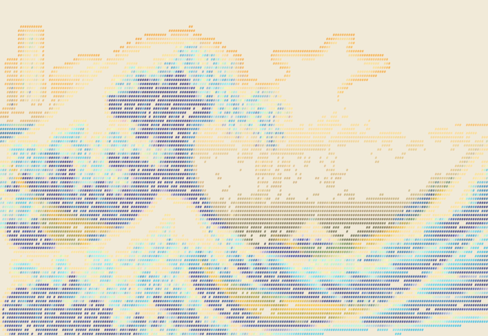
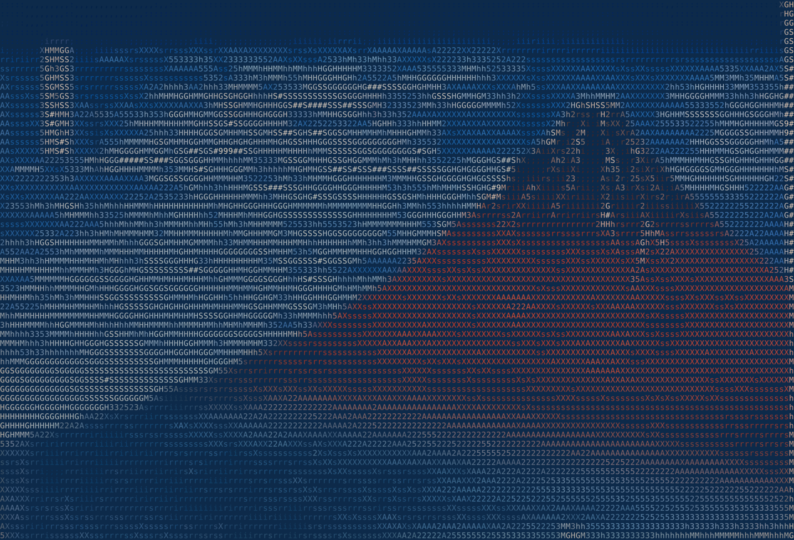
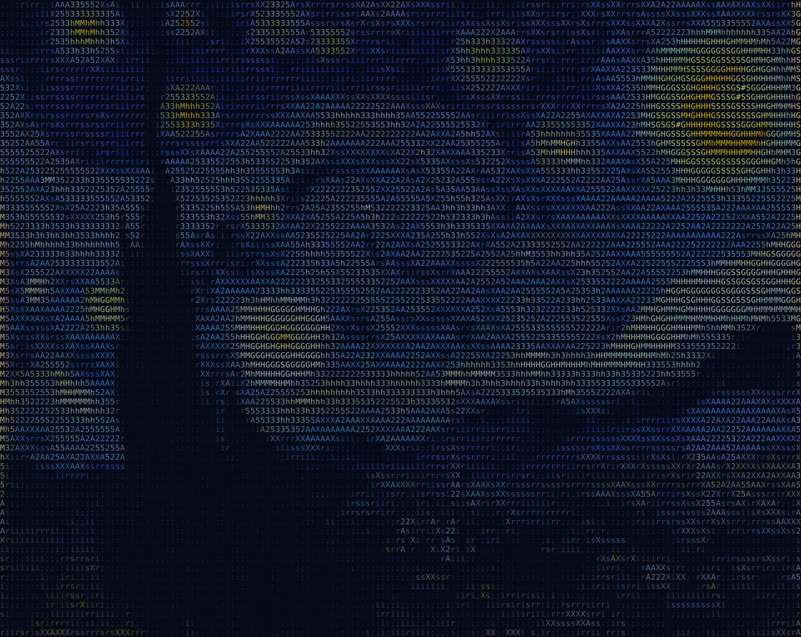

# Examples

Five complete ASCII artworks generated with ASCII Forge. Each entry includes a
still, an animated GIF and an MP4. The source artworks are public domain; the
ASCII conversion, color sampling, effects and animation are original.

The animated logo is documented separately in
[assets/logo/README.md](../assets/logo/README.md).

## 1. The Great Wave

[](../assets/examples/great-wave/great-wave.gif)

[PNG](../assets/examples/great-wave/great-wave.png) · [GIF](../assets/examples/great-wave/great-wave.gif) · [MP4](../assets/examples/great-wave/great-wave.mp4)

Light paper theme. Hokusai's woodblock wave rebuilt at 220 columns from an edge
pass, with source-sampled indigo, teal and coral. Slow zoom, scanline and a
brief late glitch.

## 2. Red Fuji

[](../assets/examples/red-fuji/red-fuji.gif)

[PNG](../assets/examples/red-fuji/red-fuji.png) · [GIF](../assets/examples/red-fuji/red-fuji.gif) · [MP4](../assets/examples/red-fuji/red-fuji.mp4)

Dark indigo theme. Hokusai's Red Fuji rebuilt at 160 columns with detailed color
import, keeping the source's blue sky and rust-red mountain. Slow zoom,
scanline and a short late glitch.

## 3. The Starry Night

[](../assets/examples/starry-night/starry-night.gif)

[PNG](../assets/examples/starry-night/starry-night.png) · [GIF](../assets/examples/starry-night/starry-night.gif) · [MP4](../assets/examples/starry-night/starry-night.mp4)

Dark blue theme. Van Gogh's night sky rebuilt at 160 columns with detailed color
import, preserving the deep blues, gold stars and moon. Slow zoom, scanline and
a low late glitch.

## 4. Sunflowers

[](../assets/examples/sunflowers/sunflowers.gif)

[PNG](../assets/examples/sunflowers/sunflowers.png) · [GIF](../assets/examples/sunflowers/sunflowers.gif) · [MP4](../assets/examples/sunflowers/sunflowers.mp4)

Light ochre theme. Van Gogh's sunflowers rebuilt at 160 columns with detailed
color import, keeping the yellow ground, ochre petals and olive stems. Slow
zoom, scanline and a short late glitch.

## 5. Vitruvian Man

[](../assets/examples/vitruvian/vitruvian.gif)

[PNG](../assets/examples/vitruvian/vitruvian.png) · [GIF](../assets/examples/vitruvian/vitruvian.gif) · [MP4](../assets/examples/vitruvian/vitruvian.mp4)

Light ink theme. Leonardo's Vitruvian Man rebuilt at 160 columns from a
thickened ink pass, preserving the original black-on-paper palette. Slow zoom,
scanline and a very light late glitch.

## Reproduce

The gallery uses the release binary and the source-faithful import recipes:

```bash
# Line art (Hokusai, Leonardo): preserve ink and paper
ascii-forge import source.png --cols 200 --edges --color --background efe6d2 --out scene.json
ascii-forge import source.png --cols 200 --edges --color --background f2ead8 --out scene.json

# Paintings (Van Gogh, Hokusai color): detailed color, no forced palette
ascii-forge import source.jpg --cols 160 --charset detailed --color --background 060a18 --out scene.json
ascii-forge import source.jpg --cols 160 --charset detailed --color --invert --background f2d878 --out scene.json

ascii-forge render scene.json --format png --out example.png
ascii-forge render scene.json --format gif --gif-colors 64 --out example.gif
ascii-forge render scene.json --format mp4 --width 1000 --crf 20 --out example.mp4
```

See [assets/examples/SOURCES.md](../assets/examples/SOURCES.md) for source
credits. Design parameters follow the `ascii-design` authoring recipe: one focal
subject, a clean margin, a fresh palette, bounded motion and frame inspection.
